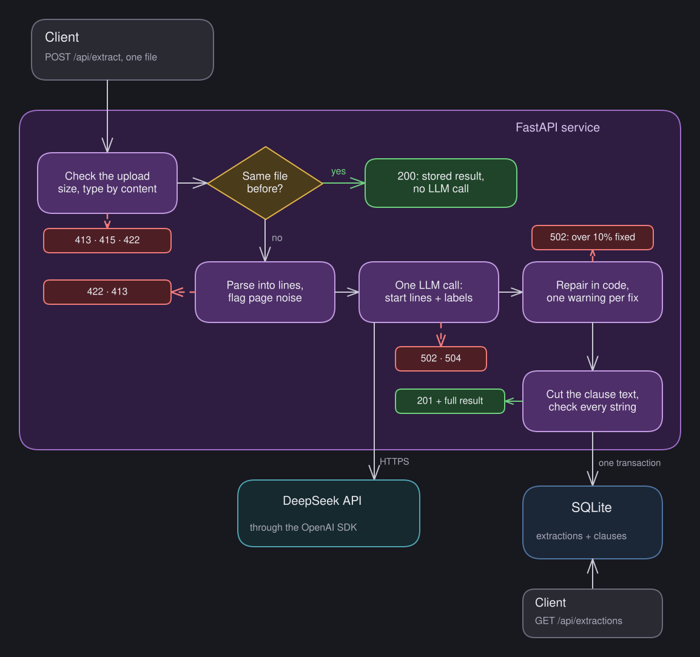
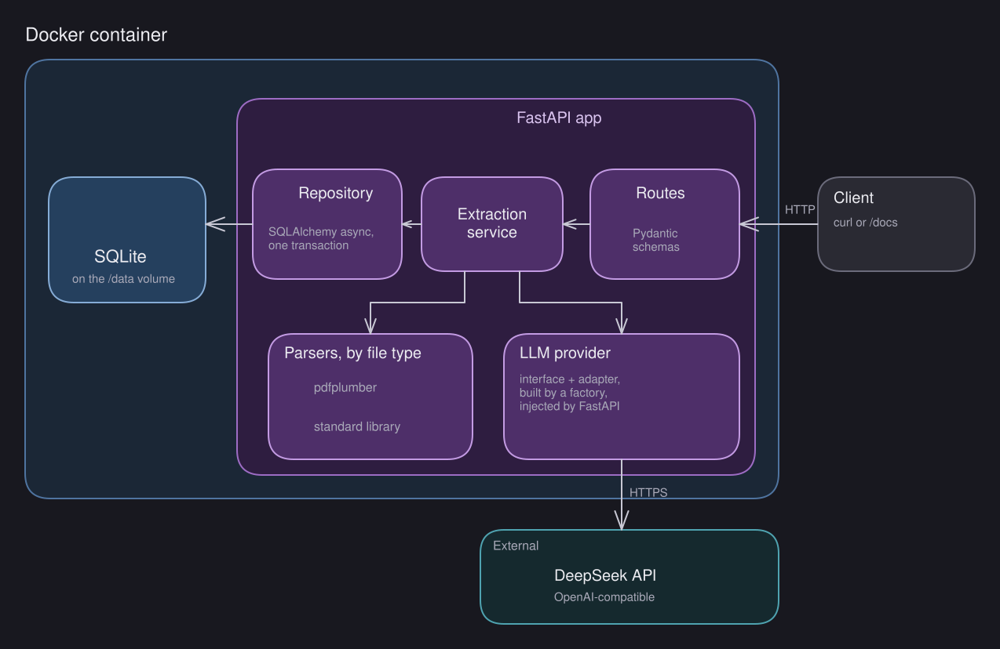
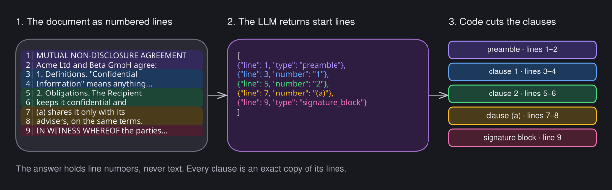
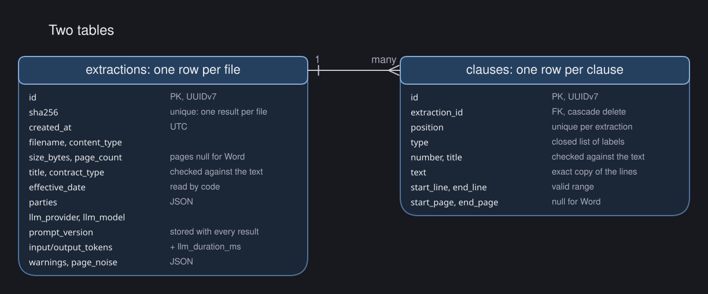

# Contract Clause Extractor

A FastAPI service that splits a contract (PDF or Word) into its clauses and stores the result. An LLM only says where each clause starts. Code cuts the text out of the document, so every clause is an exact copy of the source.

## How it works



Only one step calls the LLM. Everything else is deterministic code.

## Running it

Copy `.env.example` to `.env` and set `LLM_API_KEY` (sent separately). Every other setting is optional and documented in `.env.example`.

**With Docker:**

```bash
docker build -t clause-extractor .
docker run --rm -p 8000:8000 --env-file .env -v clause-extractor-data:/data clause-extractor
```

The container runs the migrations, then the server. The `/data` volume keeps the database.

**Without Docker** (Python 3.14 and [uv](https://docs.astral.sh/uv/)):

```bash
uv sync
uv run alembic upgrade head
uv run uvicorn app.main:app --reload
```

Either way, the API is at `http://localhost:8000` and its interactive docs are at `/docs`.

**Demo:** with the server running, put any PDF or Word files in `demo/` and run:

```bash
python demo.py
```

It needs only Python 3.12+, no packages. It uploads every file in `demo/`, uploads each again (answered from storage), reads it back, lists what is stored, and shows a refused upload. `demo/` already holds a small made-up NDA with a running header and footer and a hidden line of white text, so page noise and hidden-text removal show up too. Files can also be named directly: `python demo.py Contracts/*.pdf`.

**Tests and checks:**

```bash
uv run pytest
uv run ruff check .
uv run mypy
```

The tests never call an LLM; they use a fake one. The tests against the sample contracts are skipped when the `Contracts` folder is missing.

## Results on the sample contracts

One run of all seven samples: `deepseek-flash`, reasoning effort `high`, prompt version 3.

| Sample | Size | Clauses | LLM time |
|---|---|---|---|
| Three NDAs | 3 pages each | 11 each | 13–17 s |
| Service agreement | 23 pages | 59 | 120 s |
| Interconnection agreement | 176 pages | 287 | 123 s |
| Service agreement, Word | 102 lines | 56 | 69 s |
| Master agreement, Word | 113 lines | 99 | 111 s |

- **Every sample was also checked by hand.** Of 520 clear-cut clause starts, the API found all 520. Its 14 extra parts were judgement calls, such as unnumbered headings and template placeholders. Every clause number and every clause text matched the document exactly.
- **Reasoning effort trades time for recall.** At `none`, the service agreement took 6 s instead of 150 s, but it gave 53 parts instead of 59 and missed Exhibit A. `.env.example` uses `none`, so the demo runs in seconds; set `high` for the thorough run.

## Design decisions



### How the LLM is used



- **The model returns line numbers, never text.** The parser numbers the lines. The model says on which line each clause starts, gives the clause's label, number and title, and adds a few facts about the contract. Code cuts the text. Because the answer is small, a 176-page contract fits in one call.
- **It gives starts, not ranges.** A clause runs until the next start, so clauses cannot overlap or leave gaps. The worst failure is two clauses merged, with every word still present.
- **Every provision that starts on its own line is a clause**, at any depth, in one flat list. The clause number (`18.3.11`) shows the hierarchy.
- **A flawed answer is repaired in code, not sent back to the model.** A second call costs time and money, and can repeat the mistake. Every fix is reported in `warnings`.
- **Every string the model returns is checked against the document.** A value that is not written there becomes `null`, with a warning.

### The prompt

[extract_v3.md](app/extraction/prompts/extract_v3.md) is the system prompt. The contract follows it as numbered lines inside `<document>` tags, which the model is told to treat as data, never as instructions. It lists where a part starts and where it does not, the closed lists of labels, and how to copy metadata. Earlier versions stay next to it, and the prompt version is stored with every result.

- **v1** came from the first runs. It allows a party with no name, tells the model to go all the way down (without that: 31 parts instead of 54), and to apply the same rules inside exhibits.
- **v2** starts the signature block at "IN WITNESS WHEREOF" and adds examples for labels that are easy to confuse.
- **v3** says a part starts at its heading, not at the paragraph below it.

### Repairing and checking the answer

| Problem in the answer | Fix | Warning |
|---|---|---|
| Start on a missing line, or on page noise | Drop it | `clause_start_on_missing_line`, `clause_start_on_page_noise` |
| Entry without a usable line number | Leave it out | `clause_start_unreadable` |
| Starts out of order, or two on one line | Sort, keep the first | `clause_starts_reordered`, `clause_start_repeated` |
| Start one line below its title or below an attachment heading | Move it up | `clause_start_moved_to_title`, `clause_start_moved_to_heading` |
| A reference wrapped onto a new line ("…in Article" / "2.3.1. During…") | Drop it | `clause_start_in_mid_sentence` |
| First start is not on the first line | Add a preamble part | `preamble_added` |

If more than 10% of the starts needed a fix, the answer cannot be trusted and the request fails with `502`. One fix is always allowed. Unknown labels become `other`, with a warning, and do not count towards the 10%.

Each string the model returns must then be found in the document. A clause number must be at the start of its clause, a title in its first three lines, and the metadata anywhere. Whitespace and the style of quotes and dashes may differ; nothing else may. A value that is found is stored in the document's own characters. Code then reads the effective date.

### Provider

- **One interface, one adapter per provider API, a factory driven by settings, injected by FastAPI.** Switching to another OpenAI-compatible provider is a settings change. The tests inject a fake.
- **DeepSeek is the default, chosen for cost.** For real client contracts the provider would be picked on its data terms (region, retention, use for training).

### Parsers

- **PDF: pdfplumber.** It is slower than pypdfium2, but it returns lines in visual order, which numbering the lines and finding headers and footers depend on.
- **Page headers, footers and page numbers are flagged, not deleted.** They are left out of the prompt and the clause text, and listed in the response. The rules are conservative: a stray footer inside a clause is harmless, lost contract text is not. On the samples they flag every header, footer and page number, and nothing else.
- **Hidden text is removed and reported**: white text on a white background in a PDF, and Word's hidden attribute. It is the obvious place to plant instructions for an LLM.
- **Word: computed clause numbers.** Word stores a paragraph's list and level, not its number. The parser computes `1.`, `1.1` and `(a)` the way Word shows them. It uses the standard library, because python-docx has no number labels and skips content controls.

### Data model



In production I would split further:

| Split | When |
|---|---|
| `documents` + `extraction_runs` | Re-processing after a prompt or model change, run history |
| `parties` table | Searching by party |
| `llm_calls` table | Chunking: many calls per extraction |

A result is written in one transaction, so it is complete or absent. No database connection is held during the LLM call.

### API

- **`POST /api/extract` takes one file and returns `201`** with the result and a `Location` header. A size middleware refuses oversized bodies while they stream in, before FastAPI buffers them. The file type is decided by content, not by name.
- **The same file returns its stored result with `200` and no LLM call.** If two uploads of a new file race, the first write wins and both get it.
- **`GET /api/extractions/{id}` returns exactly the upload's body.** `GET /api/extractions` returns summaries with no clause text, newest first, with `limit` and `offset` in the body.

### Logging

One line of text per event, with a request id on every line. Contract content is never logged: no text, prompt, answer, file name or warning message, and a test checks this.

## Assumptions

- **PDFs have a text layer.** Scanned documents are refused, because there is no OCR.
- **One column.** Side-by-side text, such as signature blocks and tables, is read left to right across the page, so it comes out interleaved.
- **Contracts are in English.** The prompt, the month names in dates, and the words that mark a sentence running on (`Article`, `the`, `of`) are English.
- **Labels are best effort.** A borderline clause can get another label on the next run; boundaries are much more stable.
- **Metadata must be written in the contract.** Dates written only in numbers (`03/04/2021`) are not guessed, and a date such as "the next business day after…" is not computed.
- **Word has no pages.** Length is estimated at 3,000 characters a page. Text boxes and footnotes are not read but are reported, tracked changes are read as accepted, and comments are ignored.
- **Uploads are synchronous and one file at a time.** That is fine for a person running it, not for production.
- **DeepSeek is acceptable for sample contracts.** It is not assumed to be acceptable for client data.
- **The LLM provider is up.** When it is not, an upload fails with `502` or `504` after the SDK's retries, and nothing is stored. Reads and repeat uploads still work. There is no circuit breaker or overall deadline, so with the defaults a failing upload can take about 15 minutes.

## What I'd do with more time

1. **Split long contracts into chunks and call the LLM in parallel.** The model returns line numbers, so merging the chunks is a sort. The care is at the chunk edges.
2. **Read tables and side-by-side columns properly**, by detecting columns from word positions before the lines are built. Today the samples' signature blocks and a few appendix tables come out interleaved.
3. **Re-process documents** by splitting storage into `documents` and `extraction_runs`, so a file can run again after a prompt or model change and keep its run history. Today a file has one result that is never replaced.
4. **Process in the background**: return `202` and poll or send a webhook, with pre-signed uploads, batch uploads and cancellation.
5. **Add production basics**: authentication and tenant isolation, with duplicate detection scoped per tenant so one customer's upload never returns another's result, rate limits by token spend, a circuit breaker with provider fallback, an overall LLM deadline, JSON logs, metrics, health checks, and PostgreSQL with keyset pagination.
6. **Make the API richer**: a nested clause hierarchy, search by clause type and metadata, RFC 9457 errors, model choice per request, and streaming the clauses as server-sent events.
7. **Handle more input**: OCR for scans, PDF parsing in a process pool, white text in Word, and more prompt-injection hardening.
8. **Build a review UI** that shows each clause highlighted in the original.
