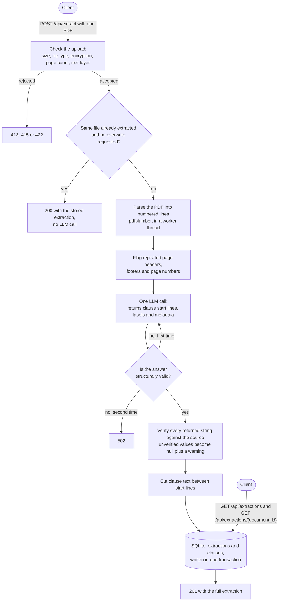

# Contract Clause Extractor

> Draft. Sections are added as the design is agreed; setup, assumptions and the diagram are still to come.

## How it works

Only one box calls the LLM. Everything else is deterministic code, and the clause text in the response is always copied from the source by that code.

## Design decisions and trade-offs

### How the LLM is used

The LLM never writes contract text. Code parses the document into numbered lines, the model answers with line numbers and labels, and code cuts the clause text out of the source.

- **One call per contract, one structured answer.** The prompt is a versioned file; its version and the model are stored with every extraction.
- **The model returns where each clause starts**, not a range. A clause runs until the next start, so clauses cannot overlap, leave gaps or lose text. The worst failure is two clauses merged, with every word still present.
- **Every provision that starts on its own line is a clause**, at any depth, labelled with a type from a closed list. The result is one flat list with no parent-child structure. Where a contract is hierarchical, the clause number (for example `18.3.11`) shows it.
- **Structural errors fail loudly.** If a line number does not exist or the order is wrong, the model is asked once more with the error. After that the request fails with `502`; there are no partial results.
- **Every string the model returns is checked against the source.** Clause numbers and titles must appear in the clause's first line, and metadata values must appear in the document. A value that fails the check becomes null and is reported in `warnings`.
- **Dates are parsed by code** from the text as written in the contract.
- **Page headers, footers and page numbers are flagged, not deleted.** A conservative rule flags them before the call. Flagged lines are left out of the prompt and of the clause text, line numbers do not change, and the response lists what was left out. A line the rule misses stays inside a clause, because leaving noise in is safer than dropping contract text.

What this guarantees is narrow and checkable: the model cannot alter contract text. It can still put a boundary in the wrong place or pick the wrong label, and the checks above are there to catch that.

### LLM provider and model

- **The provider is configuration, not code.** The LLM sits behind one small interface. The provider name, base URL, API key, model and reasoning effort come from environment variables.
- **Four small pieces make that work.** The pipeline depends on one interface (Strategy). Each provider is an adapter that translates the interface to a vendor SDK and maps its errors to ours (Adapter). A factory builds the adapter named in the environment and fails at startup on an unknown name (Factory). FastAPI injects it into the extraction service, which is also how the tests swap in a fake (dependency injection).
- **Adapters know nothing about contracts.** They send text and return text plus token usage. The prompt, the parsing of the answer and every check live in the extraction code, so adding a provider is one small class and one line in the factory.
- **The default is DeepSeek**, called through its OpenAI-compatible API with the official `openai` SDK. Any other OpenAI-compatible provider is a change of environment variables; a provider with a different API is one new class behind the same interface.
- **The answer is requested in JSON mode and validated by this service.** I do not rely on a provider-specific strict-schema feature, so the same checks apply to every provider. An empty or invalid answer is treated like any other structural error: one re-ask, then `502`.
- **Retries, backoff and timeouts come from the SDK**, configured once, with one overall deadline per request.
- **DeepSeek is a development default, chosen for cost.** For real client contracts the provider has to be chosen on its data terms (region, retention, use for training), which is the reason it is configuration.

### PDF parsing

I compared two permissively licensed libraries on the sample contracts (Python 3.14, best of three runs):

| | pypdfium2 | pdfplumber |
|---|---|---|
| 3-page NDA | 0.005 s | 0.11 s |
| 23-page service agreement | 0.06 s | 1.6 s |
| 176-page agreement | 0.17 s | 6.4 s |
| Footer is the last line of its page (176-page agreement) | 0 of 176 pages | 176 of 176 pages |

I chose pdfplumber. pypdfium2 is 20 to 40 times faster, but it returns text in the order it is stored in the file, so footers and page numbers land at the top or in the middle of a page. pdfplumber returns lines in visual order, top to bottom, which is what numbering the lines and removing page headers and footers depend on. Correctness matters more than speed here, and a few seconds of parsing is small next to the LLM call. PyMuPDF was not a candidate because it is AGPL-licensed.

Parsing runs in a worker thread so it does not block the event loop.

### Data model

Two tables:

- `extractions`, one row per file. The same file always maps to the same row and the same id, enforced by a unique constraint on the SHA-256 of its bytes. The row holds the file facts (name, size, page count, hash), the contract metadata, the LLM run facts (model, prompt version, token usage, duration), any warnings, and the page noise that was left out of the clause text.
- `clauses`, one row per clause in document order: its position, type, number, title, text, and where it sits in the source (lines and pages).

I kept it at two tables on purpose. A row is written once and only ever replaced as a whole, nothing queries inside the JSON columns, and the API exposes the document and its extraction as a single resource. These are the splits I would make in production, and what would trigger each:

| Split | Trigger |
|---|---|
| `documents` and `extraction_runs` (one document, many runs) | Run history, stable document ids and explicit re-processing; see below |
| `parties` table in place of the JSON column | Searching contracts by party |
| `llm_calls` table, one row per call | Chunking, when one extraction makes many LLM calls |
| `clause_types` lookup table | Clause types that customers can configure |

**One result per file.** In this version the same file always gets the same id and has exactly one stored result. In production I would split this into `documents` and `extraction_runs`, for three reasons:

- Document ids stay stable when the prompt or the model improves, because a new run does not create a new document.
- Customers get a run history for audit.
- Customers can explicitly re-process a document.

Duplicate detection would be scoped per customer, so one customer's upload never reveals or returns another customer's document.

**Flat clauses.** Clauses are stored without a level or a parent. The hierarchy is still visible in each clause's number, and storing it explicitly is on the list of later work.

### API

- **One file per request.** `POST /api/extract` takes a single PDF as multipart form data, runs the extraction synchronously and returns `201` with the full result and a `Location` header.
- **The upload limit is enforced while the body arrives.** FastAPI reads a whole upload before the endpoint runs, so a size check inside the endpoint comes too late. A small middleware refuses a declared `Content-Length` over the limit before reading anything, and counts a streamed body so that a missing or wrong `Content-Length` cannot get around it.
- **The file type is decided by content.** The first bytes must be a PDF header. The file name and the content type the client declares are ignored.
- **One resource.** The stored result is read back with `GET /api/extractions/{document_id}`. The list endpoint returns summaries without clause text.
- **Same file, same id.** A file is identified by the SHA-256 of its bytes, so uploading it again never creates a second result. A repeat upload returns the stored result with `200` and makes no LLM call. `?overwrite=true` runs the extraction again and replaces the stored result, keeping the id.
- **Clauses are a flat list in document order.** There is no nesting. Where a contract is hierarchical, each clause's `number` shows where it sits.
- **Pagination data is in the response body** (`items`, `total`, `limit`, `offset`), using limit and offset. It is typed, it appears in the OpenAPI docs for free, and it is hard to miss. `Link` headers would be the alternative.
- **One small error shape for every failure**: `{"error": {"code": "...", "message": "..."}}`. The status code says where the problem is: `413`, `415` and `422` for the upload, `404` for an unknown id, `502` and `504` for the LLM.

## What I'd do with more time

The submission is deliberately scoped to the core flow. These are the things I left out on purpose, with the reason each one matters. The first is what I would build next; the rest are grouped by theme.

### First: divide and conquer for long contracts

The whole contract goes to the LLM in a single call. A long contract is therefore slow, and one failed call wastes all of it. Next I would:

1. Split the numbered lines into chunks at page breaks.
2. Send the chunks to the LLM in parallel, a few at a time.
3. Validate each chunk's answer on its own, and retry only the chunk that failed.
4. Merge the answers by line number.

Because the model only returns line numbers, the merge is a sort and there is nothing to reconcile. The care is needed at chunk edges, where a chunk can begin in the middle of a clause.

### Ingestion and processing

- **Direct-to-storage uploads.** The API receives the file bytes itself. In production I would hand the client a pre-signed upload URL, so the file goes straight to object storage and the API only ever handles a reference to it. That keeps large PDF and Word payloads off the application servers and gives virus scanning, encryption at rest and retention policies an obvious home.
- **Event-driven background extraction.** A "file uploaded" event from storage would start a background job (a queue consumer or a serverless function) that runs the extraction and moves the document through `uploaded → processing → completed / failed`. `POST /api/extract` would return `202 Accepted` with a document id, and clients would poll `GET /api/extractions/{document_id}` or receive a webhook. Extraction time is dominated by the LLM call, so the synchronous endpoint is the biggest compromise in this submission: it holds an HTTP connection open for work that can outlast a proxy timeout.
- **Batch uploads.** `POST /api/extract` accepts one file per request. I would let it take several files and process them in parallel, which is faster for the client than uploading them one by one. Each file would get its own result or its own error, so one bad file does not fail the batch. This fits best on top of the background-job design above, where every file becomes its own job.
- **Cancellation.** Once extraction runs as a job, cancelling an upload should also cancel the in-flight LLM call, so we stop paying for output nobody will read.
- **Documents and extraction runs.** A file has one stored result, keyed by its hash. I would split that into `documents` and `extraction_runs`, with duplicate detection scoped per customer. The reasons are in the data model section above.
- **Scanned documents.** A PDF without a text layer needs OCR. I would add it as a separate, explicitly lower-confidence path, because an OCR error in a contract is not cosmetic. OCR is slow per page, so this is also where splitting the work by page and running it in parallel pays off; plain text extraction is fast enough not to need it.
- **Tables and complex layouts.** Plain text extraction flattens tables and multi-column pages. A layout-aware parser would keep them as structured data.

### Extraction quality

- **A labelled evaluation set.** Contracts with hand-checked clause boundaries and types, scored on every prompt or model change, so a regression is caught before it ships and not by a lawyer.
- **Model-flagged page noise.** A stray line such as a one-off footer stamp stays inside a clause. The model could point at such lines as well, as long as every removed line is reported in the response and never silently dropped.
- **Human review.** Surface the segments the pipeline is least sure about to a reviewer, and feed the corrections back into the evaluation set.

### API

- **Clause hierarchy and merge options.** Clauses are stored as one flat list. I would store each clause's level and parent as well, and add a query option on the read endpoints (for example `sameLevel` or `nested`) that lets the caller choose how the clauses are combined.
- **Search and filtering.** Each clause carries a type such as confidentiality, termination or governing law. Filtering a document's clauses by type, and searching across documents by clause type or contract metadata, builds directly on that.
- **RFC 9457 problem details.** Errors use a small custom shape (`code` and `message`). I would switch to the standard `application/problem+json` format, so clients and gateways can handle errors without knowing this API.
- **Model and reasoning effort per request.** The provider, model and reasoning effort are set in the environment. I would list the configured models through the API and let a request pick one, together with a reasoning effort, to trade cost and speed against accuracy per document.

### Running it in production

- **Authentication and tenant isolation.** Contracts are confidential. Every extraction would belong to a tenant and every query would be scoped to it.
- **Rate limiting and per-tenant quotas**, aware of token spend and not only of request counts.
- **Circuit breaker and provider fallback** around the LLM call, so an upstream outage fails fast.
- **Metrics, tracing and alerting.** Latency and token usage per stage, validation-failure rate and cost per document, with alerts on error rate and spend.
- **PostgreSQL and keyset pagination** in place of SQLite and offset pagination.
- **Parse PDFs in a process pool.** pdfplumber is pure Python, so a long parse slows other requests while it runs. A process pool would isolate it.
- **Health checks.** Liveness and readiness endpoints for the container orchestrator and load balancer.
- **Prompt-injection hardening.** Contract text is untrusted input to the model. The model has no tools and its output is validated against the source, which limits what an injected instruction can do. I would add adversarial test contracts and monitoring for unusual outputs.
- **CORS**, restricted to known origins, once a browser client exists.
- **Response compression at the edge** (reverse proxy or gateway) and not in the application.

### Product

- **A small review UI.** Upload a contract and read the extracted clauses next to the original, with each clause highlighted in the source.
